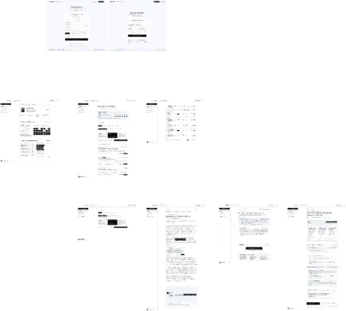

# DolyNation — Documentación

DolyNation (Dolynglish) es una aplicación web de aprendizaje de idiomas que
genera lecturas con IA, evalúa la comprensión del usuario y analiza el
vocabulario en contexto. Este repositorio centraliza **toda la documentación
del proyecto**: el anteproyecto (Unidad 1) y la documentación de control de
versiones, diagramas y diccionario de datos (Unidad 2), además de las
convenciones, la arquitectura, el plan y el onboarding.

> El código vive en repos separados (ver abajo). Este repo no contiene el
> backend, el frontend ni la infraestructura.

## Repositorios de la organización

| Repo | Contenido |
| --- | --- |
| [`dolynation-tonatiuh-front`](https://github.com/DolyLanguagesORG/dolynation-tonatiuh-front) | Frontend web (Next.js 16) |
| [`dolynation-atl-back`](https://github.com/DolyLanguagesORG/dolynation-atl-back) | API REST (NestJS 11 + Drizzle + PostgreSQL) |
| [`dolynation-tlalli-infra`](https://github.com/DolyLanguagesORG/dolynation-tlalli-infra) | Docker Compose + schema SQL (dueño de la BD) |
| [`dolynation-ehecatl-docs`](https://github.com/DolyLanguagesORG/dolynation-ehecatl-docs) | Este repo: documentación |
| [`doly-languages`](https://github.com/DolyLanguagesORG/doly-languages) | Monorepo original (archivado, histórico) |

---

# Unidad 1 — Anteproyecto

El documento académico del proyecto: problema, justificación, alcance, MVP,
requerimientos, análisis de riesgo, roles, cronograma y entrega.

| Documento | Qué contiene |
| --- | --- |
| **[Anteproyecto del proyecto](./anteproyecto/anteproyecto-dolynation.md)** | El documento completo de la Unidad 1, con el índice navegable, los diagramas y el cronograma de 5 sprints |

### Maquetado y prototipo

El diseño y el prototipo están en **Figma** y su vista previa está versionada
en este repositorio:

- **Prototipo**: <https://www.figma.com/design/NpeSJlQsZhpa0233xNcYkP/DolyNation>
- **[Guía del prototipo](./operations/PROTOTIPO-FIGMA.md)**: dónde está, cómo se
  re-exporta la imagen y cómo se mantienen los tokens de diseño.

---

# Unidad 2 — Control de versiones, diagramas y diccionario de datos

## Flujo de trabajo y versionado

| Documento | Qué contiene |
| --- | --- |
| **[Flujo de trabajo](./operations/FLUJO-DE-TRABAJO.md)** | Ramas, tablero, CODEOWNERS, dependencias, releases y qué reglas bloquean de verdad |
| **[Cómo hacer un Pull Request](./operations/COMO-HACER-UN-PR.md)** | Paso a paso: rama, checks, `Closes #N` y troubleshooting |
| **[CI/CD y versionado](./operations/CI-CD-Y-VERSIONADO.md)** | Entornos, `rc`, cascada de releases, versionado y deploy |
| **[Justificación de la plataforma](./operations/JUSTIFICACION-GITHUB.md)** | Por qué **Git** y **GitHub**: criterios, alternativas descartadas y límites reales |
| **[Plan de despliegue](./operations/PLAN-DE-DESPLIEGUE.md)** | Los 3 entornos, puertos, secretos y flujo de despliegue |

## Configuración del entorno de versiones

| Elemento | Dónde |
| --- | --- |
| Reglas de protección, checks obligatorios y aprobaciones | *Rulesets* de la organización (3 por repositorio) |
| Quién revisa cada ruta | `.github/CODEOWNERS` de los cuatro repositorios |
| Archivos excluidos | `.gitignore` de los cuatro repositorios |
| Credenciales y reporte de fallos | `SECURITY.md` + secret scanning y push protection activos |
| Plantillas de issues y PRs | `.github/ISSUE_TEMPLATE/` y `PULL_REQUEST_TEMPLATE.md` |
| Actualizaciones de dependencias | `.github/dependabot.yml` (npm + GitHub Actions) |

## Diagramas del sistema

Están en **Mermaid**, que GitHub renderiza de forma nativa: se ven en el propio
archivo, sin plugins y sin exportar imágenes.

| Diagrama | Qué muestra |
| --- | --- |
| **[Arquitectura](./diagrams/diagrama-de-arquitectura.md)** | Los cuatro repositorios, los módulos del backend, el frontend, la base de datos y los servicios externos |
| **[Actores y casos de uso](./diagrams/diagrama-de-actores.md)** | Actores humanos, casos de uso del estudiante y servicios externos |
| **[Entidad-relación (DER)](./diagrams/diagrama-de-ER%28Entidad-Relacion%29.md)** | Las 9 tablas, sus claves y sus relaciones |
| **[Secuencia — flujo principal](./diagrams/diagrama-de-secuencia.md)** | Generación de la lectura, diccionario con TTS y evaluación PNL |
| **[Secuencia — autenticación](./diagrams/diagrama-de-secuencia-de-securidad.md)** | Login, JWT, rotación del refresh token y qué es flujo objetivo |

## Diccionario de datos

| Documento | Qué contiene |
| --- | --- |
| **[Diccionario de datos](./diagrams/diccionario-de-datos.md)** | Por tabla: cada campo con su tipo, restricciones, llave primaria o foránea y descripción |

---

# El resto de la documentación

| Documento | Qué contiene |
| --- | --- |
| **[Convenciones](./conventions/README.md)** | Ramas, commits, contrato de la API, base de datos, seguridad, versionado y pruebas |
| **[Arquitectura](./architecture/README.md)** | Módulos del backend, modelo de datos y decisiones |
| **[Onboarding](./onboarding/README.md)** | Levantar el entorno (local o en Codespaces) |
| **[Cronograma](./plan/cronograma.md)** | Los 5 sprints, sus fechas, responsables y entregables |
| **[Plan y seguimiento](./plan/PLAN-Y-SEGUIMIENTO.md)** | El orden de trabajo, las dependencias y cómo justificar atrasos |
| **[Decisiones](./decisions/README.md)** | Los ADR con contexto, alternativas y consecuencias, y las decisiones pendientes |
| **[Backlog](./plan/backlog.md)** | Mejoras sueltas que no forman parte de los 5 sprints |
| **[Assets](./assets/README.md)** | Logo, capturas y material de presentación |

## Documentación adicional

- [`dolynation-atl-back` README](https://github.com/DolyLanguagesORG/dolynation-atl-back) — quick start, scripts, arquitectura del backend.
- `TYPESCRIPT_STANDARDS.md` — reglas no negociables de TypeScript (en el repo del backend).
- [`dolynation-tlalli-infra` README](https://github.com/DolyLanguagesORG/dolynation-tlalli-infra) — servicios dockerizados.

## Estado del proyecto

- Backend: activo.
- Frontend web: en construcción.
- Mobile: pausado (fuera del alcance de `v1.0.0`).
- Release vigente: `v0.1.0`; la entrega de cierre está prevista para `v1.0.0`.
- La planificación vive en GitHub: [Project con Kanban y Timeline](https://github.com/orgs/DolyLanguagesORG/projects/1).

## Licencia

`UNLICENSED`. El repositorio es público, pero no se ha definido una licencia
abierta, así que todos los derechos quedan reservados.
