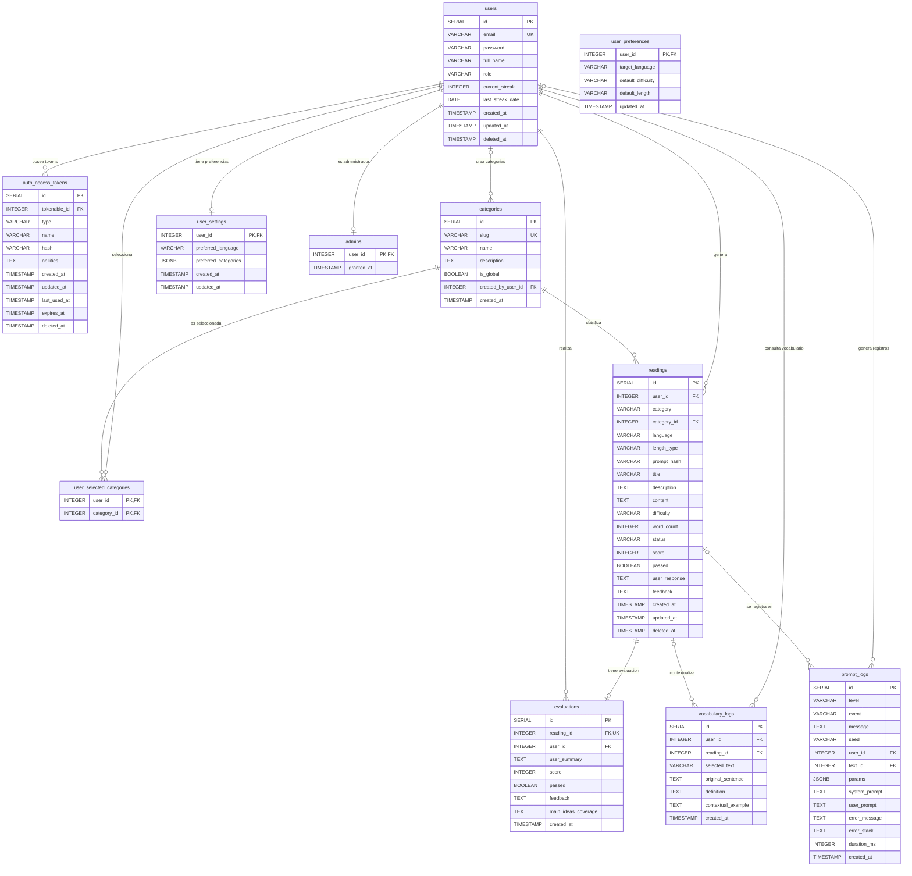

# Diagrama entidad-relación

Modelo de datos de PostgreSQL: sus claves y sus relaciones.

**Las entidades con un comentario `%% planificada` (o `%% no se creo`) todavía
no existen**; las demás sí están en la base de hoy. La fuente de verdad del DDL es
`dolynation-tlalli-infra`.

**Estado:** el diagrama muestra el modelo **completo**. Hoy existen seis
tablas: `users`, `auth_access_tokens`, `readings`, `prompt_logs`,
`user_settings` (`updates/06-user-settings.sql`) y `admins`
(`updates/05-admin-table.sql`). Las que faltan (`categories`, `evaluations`,
`vocabulary_logs`) llegan con las migraciones de los sprints 2 y 3
(`infra#20`, `infra#21`).

Dos cosas del plan original cambiaron: `user_preferences` +
`user_selected_categories` se sustituyeron por **una** tabla,
`user_settings`; y la columna `users.role` se sustituyó por la tabla
`admins`. El detalle campo por campo está en
[`diccionario-de-datos.md`](./diccionario-de-datos.md).

