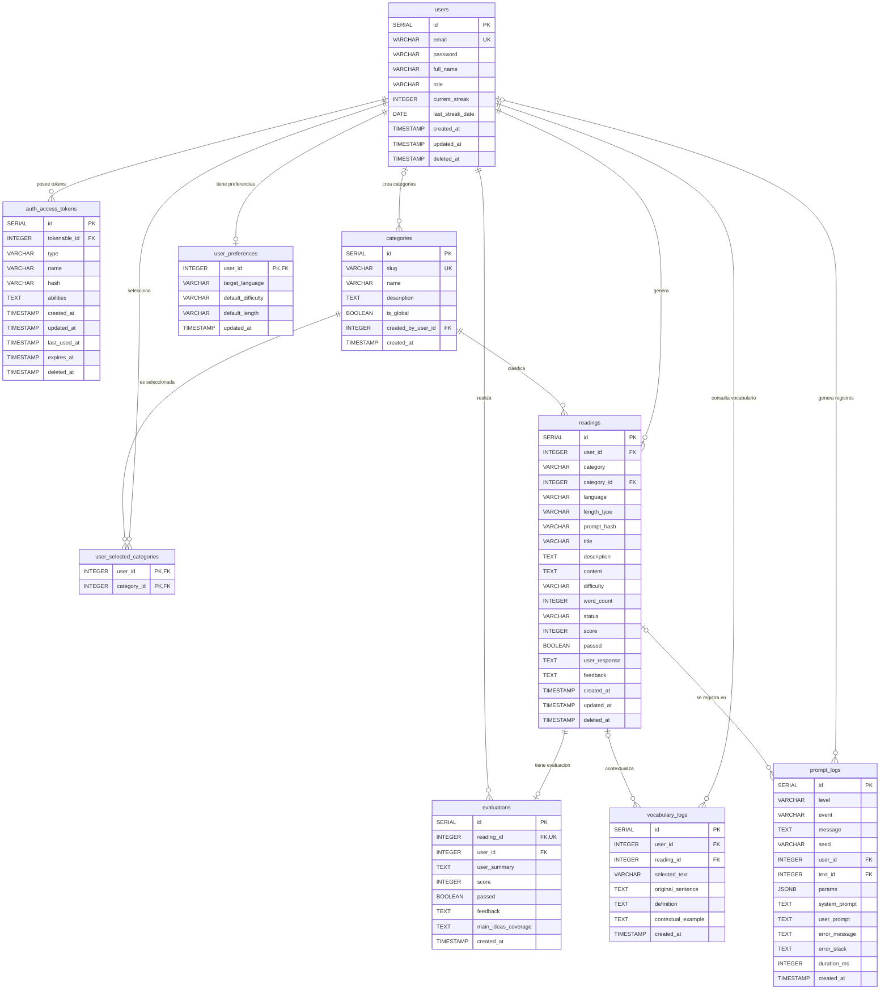

# Diagrama entidad-relación

Modelo de datos de PostgreSQL: diez tablas, sus claves y sus relaciones.

**Estado:** el diagrama muestra el modelo **objetivo**. Hoy existen `users`, `auth_access_tokens`, `readings` y `prompt_logs` (`01-init.sql`); las demás tablas llegan con las migraciones `02`, `03` y `04` (`infra#20`, `infra#21`, `infra#22`). El detalle campo por campo está en [`diccionario-de-datos.md`](./diccionario-de-datos.md).

