# Diagrama entidad-relación

Modelo de datos de PostgreSQL (`01-init.sql`): sus claves y sus relaciones.
La fuente de verdad del DDL es `dolynation-tlalli-infra/database/postgres/01-init.sql`.

**Las entidades con comentario `%% planificada` todavía no existen**; las
**17 tablas** restantes sí están creadas y en operación.

```mermaid
erDiagram
    roles {
        SERIAL id PK
        VARCHAR name UK
        VARCHAR description
        TIMESTAMP created_at
    }

    users {
        SERIAL id PK
        VARCHAR full_name
        VARCHAR email UK
        VARCHAR password
        INTEGER role_id FK
        VARCHAR subscription_tier
        VARCHAR stripe_customer_id UK
        INTEGER current_streak
        DATE last_streak_date
        TIMESTAMP email_verified_at
        VARCHAR locale
        TIMESTAMP created_at
        TIMESTAMP updated_at
        TIMESTAMP deleted_at
    }

    user_oauth_accounts {
        SERIAL id PK
        INTEGER user_id FK
        VARCHAR provider
        VARCHAR provider_user_id
        VARCHAR provider_email
        TIMESTAMP created_at
        TIMESTAMP updated_at
    }

    user_settings {
        INTEGER user_id PK, FK
        VARCHAR preferred_language
        JSONB selected_languages
        TIMESTAMP last_language_change_at
        INTEGER language_change_credits
        JSONB preferred_categories
        JSONB saved_categories
        TIMESTAMP created_at
        TIMESTAMP updated_at
    }

    access_requests {
        SERIAL id PK
        INTEGER user_id FK
        VARCHAR request_type
        VARCHAR requested_tier
        VARCHAR current_tier
        TEXT user_message
        VARCHAR status
        TEXT rejection_reason
        INTEGER reviewed_by_user_id FK
        TIMESTAMP reviewed_at
        TIMESTAMP created_at
        TIMESTAMP updated_at
    }

    auth_access_tokens {
        SERIAL id PK
        INTEGER tokenable_id FK
        VARCHAR type
        VARCHAR name
        VARCHAR hash
        TEXT abilities
        TIMESTAMP created_at
        TIMESTAMP updated_at
        TIMESTAMP last_used_at
        TIMESTAMP expires_at
        TIMESTAMP deleted_at
    }

    auth_email_tokens {
        SERIAL id PK
        INTEGER user_id FK
        VARCHAR type
        VARCHAR token_hash UK
        TIMESTAMP expires_at
        TIMESTAMP consumed_at
        TIMESTAMP created_at
    }

    readings {
        SERIAL id PK
        INTEGER user_id FK
        VARCHAR title
        TEXT description
        TEXT content
        VARCHAR category
        VARCHAR difficulty
        VARCHAR language
        INTEGER word_count
        VARCHAR status
        INTEGER score
        BOOLEAN passed
        TEXT user_response
        TEXT feedback
        VARCHAR evaluation_operation_id UK
        TIMESTAMP created_at
        TIMESTAMP updated_at
        TIMESTAMP deleted_at
    }

    reading_explanations {
        SERIAL id PK
        INTEGER reading_id FK
        INTEGER user_id FK
        TEXT word
        TEXT normalized_word
        VARCHAR entry_type
        VARCHAR language
        VARCHAR difficulty
        TEXT context
        TEXT literal_meaning
        TEXT explanation
        JSONB word_breakdown
        JSONB other_ways_to_say
        JSONB other_contexts
        BOOLEAN is_saved
        TIMESTAMP saved_at
        TIMESTAMP created_at
        TIMESTAMP updated_at
    }

    %% planificada (infra#21)
    evaluations {
        SERIAL id PK
        INTEGER reading_id FK, UK
        INTEGER user_id FK
        TEXT user_summary
        INTEGER score
        BOOLEAN passed
        TEXT feedback
        TEXT main_ideas_coverage
        TIMESTAMP created_at
    }

    prompt_logs {
        SERIAL id PK
        VARCHAR level
        VARCHAR event
        TEXT message
        VARCHAR seed
        INTEGER user_id FK
        INTEGER text_id FK
        VARCHAR request_id
        VARCHAR ip_address
        VARCHAR provider
        VARCHAR model
        JSONB params
        TEXT system_prompt
        TEXT user_prompt
        TEXT error_message
        TEXT error_stack
        INTEGER duration_ms
        TIMESTAMP created_at
    }

    moderated_categories {
        VARCHAR canonical_key PK
        VARCHAR sample_category
        BOOLEAN allowed
        VARCHAR layer
        VARCHAR reason
        VARCHAR provider
        JSONB prompt_profile
        VARCHAR profile_model
        TIMESTAMP created_at
        TIMESTAMP updated_at
    }

    category_daily_usage {
        SERIAL id PK
        INTEGER user_id FK
        VARCHAR usage_date
        VARCHAR canonical_key
        TIMESTAMP created_at
    }

    audit_logs {
        SERIAL id PK
        VARCHAR request_id
        INTEGER actor_user_id FK
        VARCHAR actor_email
        VARCHAR actor_role
        INTEGER target_user_id FK
        VARCHAR ip_address
        TEXT user_agent
        VARCHAR http_method
        VARCHAR http_path
        INTEGER http_status
        VARCHAR module
        VARCHAR action
        VARCHAR event
        VARCHAR entity_type
        VARCHAR entity_id
        TEXT summary
        JSONB before_state
        JSONB after_state
        JSONB changed_fields
        JSONB metadata
        INTEGER duration_ms
        TIMESTAMP created_at
    }

    error_logs {
        SERIAL id PK
        VARCHAR request_id
        VARCHAR severity
        VARCHAR source
        VARCHAR module
        VARCHAR error_code
        INTEGER http_status
        TEXT message
        VARCHAR error_name
        TEXT error_stack
        INTEGER actor_user_id FK
        VARCHAR actor_email
        VARCHAR actor_role
        VARCHAR ip_address
        TEXT user_agent
        VARCHAR http_method
        VARCHAR http_path
        JSONB request_body
        JSONB request_query
        JSONB details
        INTEGER duration_ms
        TIMESTAMP created_at
    }

    billing_subscriptions {
        SERIAL id PK
        INTEGER user_id FK, UK
        VARCHAR provider
        VARCHAR stripe_customer_id
        VARCHAR stripe_subscription_id UK
        VARCHAR stripe_price_id
        VARCHAR tier
        VARCHAR status
        TIMESTAMP current_period_start
        TIMESTAMP current_period_end
        BOOLEAN cancel_at_period_end
        TIMESTAMP canceled_at
        VARCHAR payment_method_brand
        VARCHAR payment_method_last4
        INTEGER payment_method_exp_month
        INTEGER payment_method_exp_year
        TIMESTAMP created_at
        TIMESTAMP updated_at
    }

    billing_payments {
        SERIAL id PK
        INTEGER user_id FK
        VARCHAR provider
        VARCHAR kind
        VARCHAR tier
        VARCHAR stripe_checkout_session_id UK
        VARCHAR stripe_payment_intent_id
        VARCHAR stripe_invoice_id UK
        INTEGER amount_cents
        VARCHAR currency
        VARCHAR status
        TIMESTAMP fulfilled_at
        JSONB metadata
        TIMESTAMP created_at
        TIMESTAMP updated_at
    }

    billing_webhook_events {
        VARCHAR event_id PK
        VARCHAR provider
        VARCHAR event_type
        VARCHAR status
        TEXT error_message
        TIMESTAMP processed_at
        TIMESTAMP created_at
    }

    roles ||--o{ users : "asigna rol"
    users ||--o{ user_oauth_accounts : "vincula IdP"
    users ||--o| user_settings : "configura preferencias"
    users ||--o{ access_requests : "solicita acceso"
    users o|--o{ access_requests : "revisa solicitud"
    users ||--o{ auth_access_tokens : "posee refresh tokens"
    users ||--o{ auth_email_tokens : "posee tokens de correo"
    users ||--o{ readings : "genera"
    readings ||--o{ reading_explanations : "explica vocabulario"
    users ||--o{ reading_explanations : "guarda en glosario"
    readings ||--o| evaluations : "tiene evaluacion"
    users ||--o{ evaluations : "realiza"
    users o|--o{ prompt_logs : "genera prompts"
    readings o|--o{ prompt_logs : "se registra en"
    users ||--o{ category_daily_usage : "consume cuota"
    users o|--o{ audit_logs : "ejecuta accion"
    users o|--o{ audit_logs : "afecta a"
    users o|--o{ error_logs : "sufre error"
    users ||--o| billing_subscriptions : "mantiene suscripcion"
    users ||--o{ billing_payments : "realiza pagos"
```

**Notas respecto al diseño inicial:** las tablas planeadas originalmente
`admins`, `categories`, `user_preferences` y `user_selected_categories` fueron
sustituidas por `roles` (`users.role_id`), `moderated_categories` y
`user_settings`. Sigue pendiente `evaluations` (`infra#21`); el glosario y
vocabulario contextual viven hoy en `reading_explanations`. El detalle campo
por campo está en [`diccionario-de-datos.md`](./diccionario-de-datos.md).
