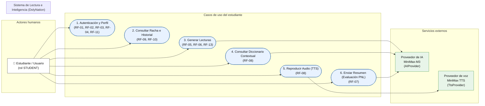

# Diagrama de actores y casos de uso

Actores humanos, casos de uso del estudiante y servicios externos del sistema de lectura e inteligencia de DolyNation.

**Estado:** el diagrama describe el modelo de casos de uso del MVP. Los casos de uso administrativos (`back#17`, `front#12`) se entregan en el Sprint 4.

