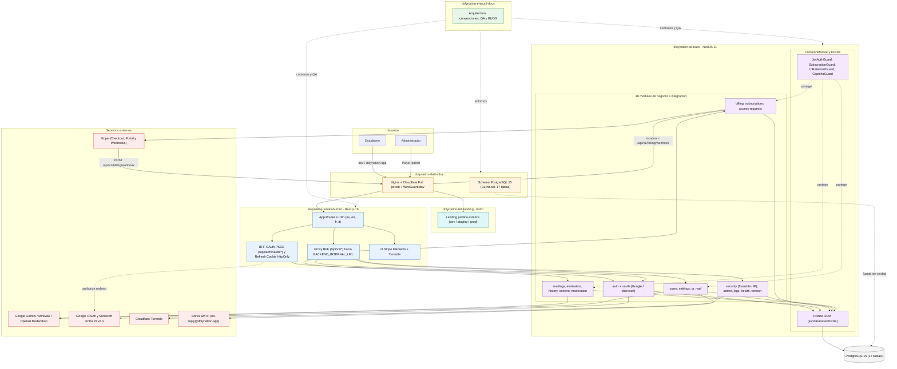

# Diagrama de arquitectura

Estructura del sistema (`v0.15.0`): los cinco repositorios activos, los módulos
del backend, los BFF de Next.js, la landing estática y los servicios externos.

**Estado (`v0.15.0`):** los módulos de autenticación (correo + Google +
Microsoft Entra ID), seguridad (Turnstile + rate limit + CORS), correo (Brevo),
lecturas, glosario, evaluación, pagos con Stripe, moderación, administración y
auditoría están implementados y en fase de pruebas ([`plan/QA-PRUEBAS.md`](../plan/QA-PRUEBAS.md)).
La landing estática (`dolynation-tetl-landing`) corre ya en `dev` (`dev.dolynation.app`)
con despliegue independiente a `staging` y `prod`.
