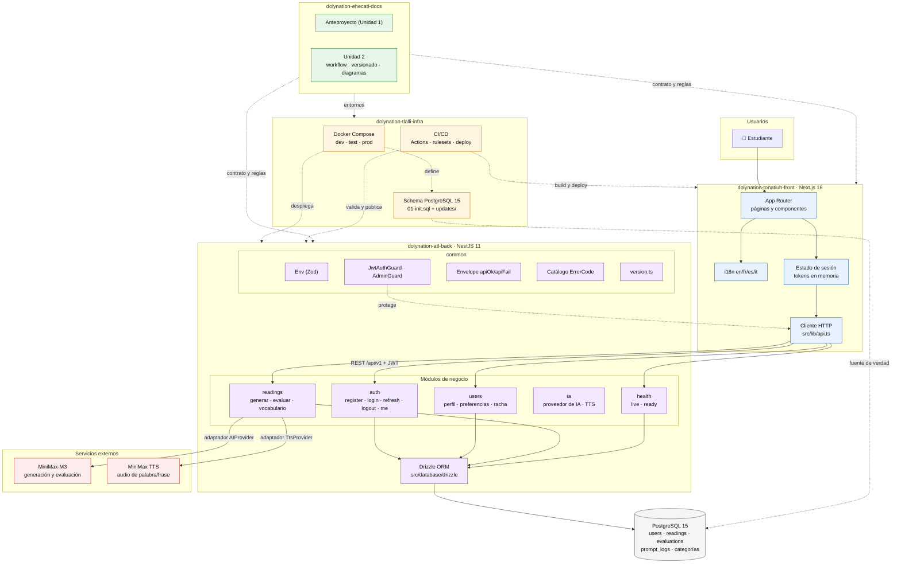

# Diagrama de arquitectura

Estructura del sistema: los cuatro repositorios, los módulos del backend, el
frontend y los servicios externos.

**Estado:** el backend tiene implementados `auth`, `users`, `readings`, `ia` y
`health`; el frontend está en construcción (`front#2` en el Sprint 2) y la
infraestructura ya tiene los tres entornos definidos.

> **Nota.** El diagrama muestra la arquitectura **objetivo**. Lo que ya está
> construido y en qué sprint llega cada parte está en
> [`../plan/cronograma.md`](../plan/cronograma.md).
