# Diagrama de secuencia — autenticación y tokens

Inicio de sesión, acceso con *access token* y rotación del *refresh token*.

```mermaid
sequenceDiagram
    autonumber

    actor U as Usuario
    participant FE as Next.js (Cliente)
    participant BE as NestJS (API)
    participant DB as PostgreSQL

    Note over U,DB: FASE 1: INICIO DE SESIÓN

    U->>FE: Ingresa email y contraseña
    FE->>BE: POST /api/v1/auth/login<br/>Body: email, password
    BE->>DB: Buscar usuario por email
    DB-->>BE: Retorna registro del usuario (incluye password)
    BE->>BE: Comparar contraseña con argon2.verify()

    alt Credenciales válidas
        BE->>BE: Generar Access Token (JWT - 15 min)
        BE->>BE: Generar Refresh Token (30 días)
        Note over BE,DB: Flujo objetivo pendiente: persistir hash del Refresh Token en auth_access_tokens
        BE-->>FE: HTTP 200 OK<br/>Access Token + Refresh Token + User Info
        FE->>FE: Guardar Access Token en memoria/contexto
        Note over FE: Refresh Token en almacenamiento seguro&#59; evitar localStorage
        FE-->>U: Redirigir al Dashboard de Usuario
    else Credenciales inválidas
        BE-->>FE: HTTP 401 Unauthorized<br/>Mensaje genérico
        FE-->>U: Mostrar error de autenticación
    end

    Note over U,DB: FASE 2: PETICIÓN PROTEGIDA CON ACCESS TOKEN

    U->>FE: Intenta generar una lectura
    FE->>BE: POST /api/v1/readings<br/>Authorization: Bearer JWT
    BE->>BE: JwtAuthGuard valida firma y expiración del JWT

    alt Access Token válido
        BE->>BE: Procesar petición y llamar a IA
        BE-->>FE: HTTP 201 Created<br/>Lectura generada
        FE-->>U: Mostrar lectura
    else Access Token expirado o inválido
        BE-->>FE: HTTP 401 Unauthorized
        Note over FE,BE: Flujo objetivo: iniciar renovación automática del token
    end

    Note over U,DB: FASE 3: ROTACIÓN DEL REFRESH TOKEN (FLUJO OBJETIVO PENDIENTE)

    FE->>BE: POST /api/v1/auth/refresh<br/>Body: refreshToken
    BE->>DB: Buscar y validar Refresh Token no revocado

    alt Refresh Token válido
        BE->>DB: Revocar Refresh Token anterior (deleted_at)
        BE->>BE: Generar nuevo Access Token y Refresh Token
        BE->>DB: Guardar hash del nuevo Refresh Token
        DB-->>BE: Confirmación de persistencia
        BE-->>FE: HTTP 200 OK<br/>Nuevo Access Token + Nuevo Refresh Token
        FE->>FE: Actualizar tokens almacenados
        FE->>BE: Reintentar petición original con nuevo Access Token
    else Refresh Token revocado o inválido
        BE-->>FE: HTTP 401 Unauthorized
        FE->>FE: Limpiar tokens y estado de sesión
        FE-->>U: Redirigir al Login
    end
```

**Estado:** el hash de contraseñas con Argon2id y el JWT con expiración ya están implementados. La **persistencia, rotación y revocación del refresh token** en `auth_access_tokens` es el flujo objetivo que implementa `back#4`.

