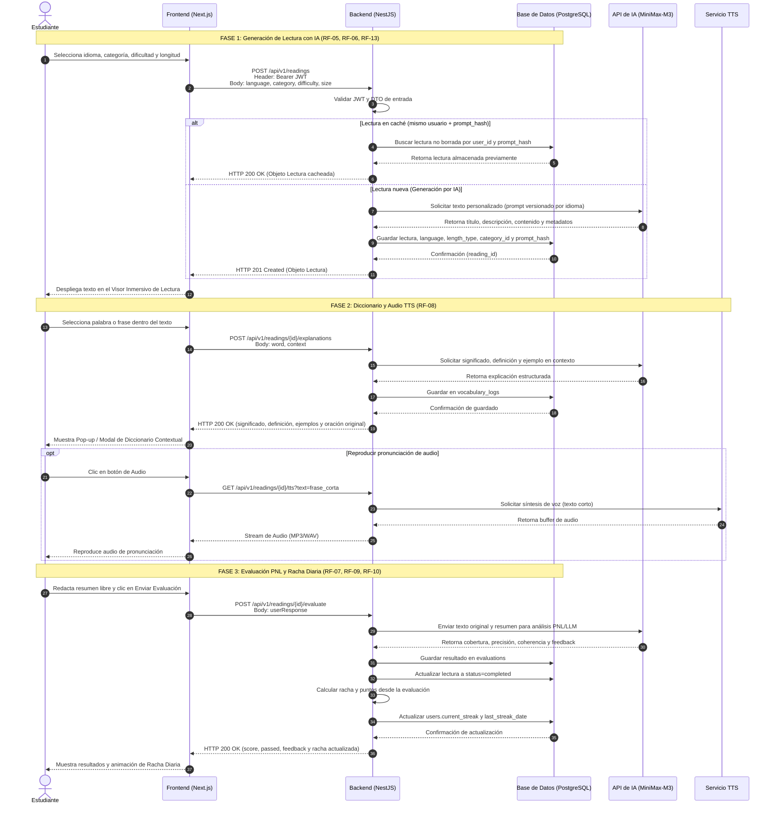

# Diagrama de secuencia — flujo principal

Las tres fases del flujo de aprendizaje: generación de la lectura con IA, diccionario contextual con audio TTS y evaluación PNL con racha diaria.

**Estado:** describe el comportamiento **objetivo**. La caché por `prompt_hash` (`back#9`), el endpoint de TTS (`back#44`) y el motor de evaluación (`back#12`) se entregan en los sprints 2 y 3.

